# Brioche

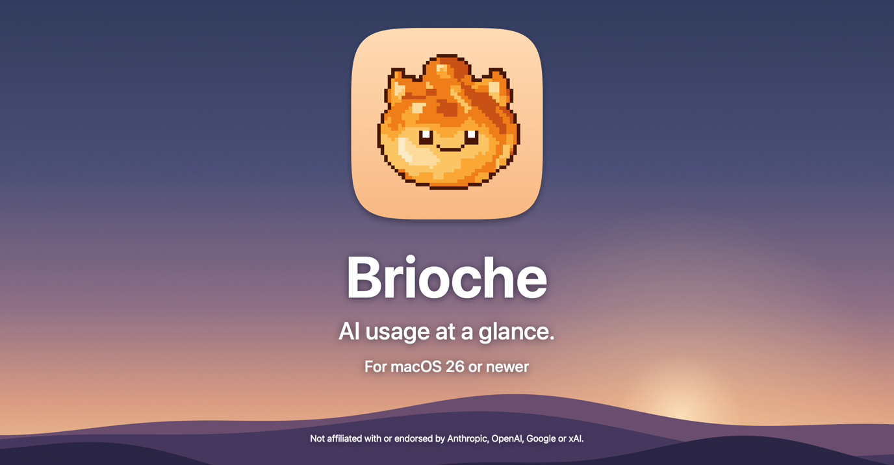

<table>
  <tr>
    <td width="56%">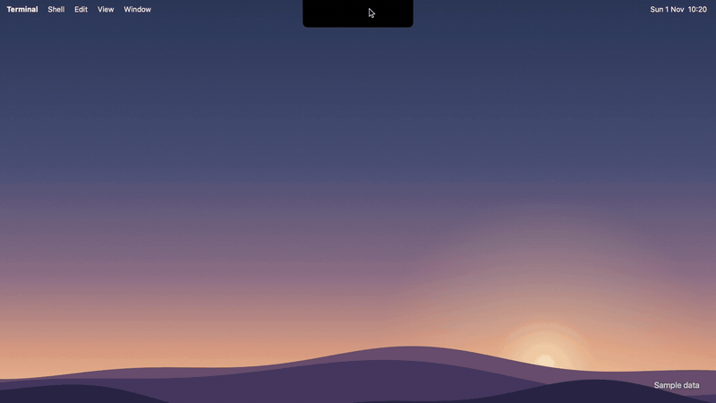</td>
    <td width="44%">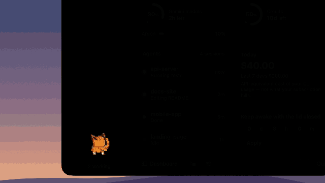</td>
  </tr>
</table>

[Watch the 30-second film](docs/brioche-promo.mp4) (MP4, no sound, sample data).

Brioche is a macOS app in your notch or menu bar for AI coding usage: Claude, Codex, Antigravity and Grok limits, local CLI cost accounting, and the agent sessions that need you.
This README is a map. Each section says what it covers and points to the next one.

> Brioche was called Omelette until 4.0. An installed copy updates itself and keeps
> everything, and the `omelette` command still works.

## Contents

- [Screenshots](#screenshots)
- [What it shows](#what-it-shows)
- [Island](#island)
- [Pet](#pet)
- [Agents at a glance](#agents-at-a-glance)
- [Command line and MCP](#command-line-and-mcp)
- [Dashboard](#dashboard)
- [Notifications](#notifications)
- [Widgets and floating window](#widgets-and-floating-window)
- [Keep awake with the lid closed](#keep-awake-with-the-lid-closed)
- [Settings](#settings)
- [How it works](#how-it-works)
- [Requirements](#requirements)
- [Install](#install)
- [Build from source](#build-from-source)
- [Disclaimer](#disclaimer)
- [License](#license)

## Screenshots

The menu bar panel (the island's predecessor) and the dashboard, one shot of each
below. More of both live in the two disclosures underneath.

<!-- screenshots: retake for 4.0 -->
<table>
  <tr>
    <td width="36%">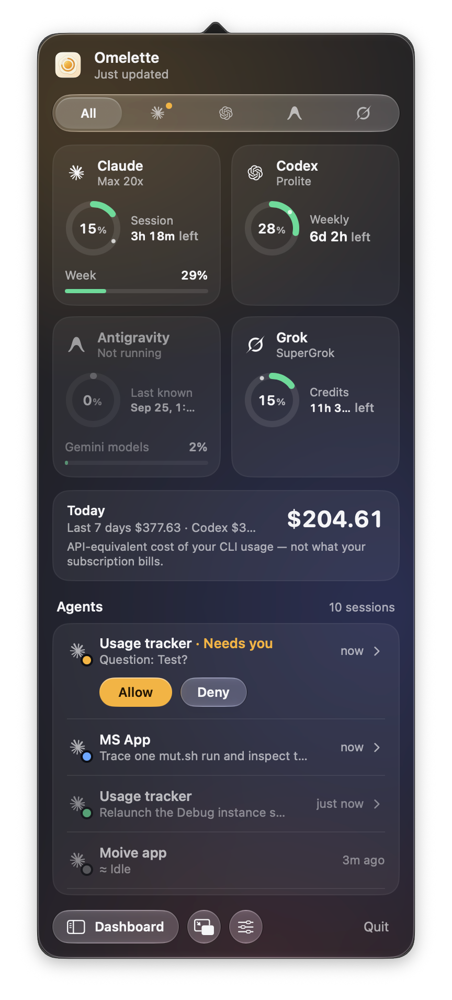</td>
    <td width="64%">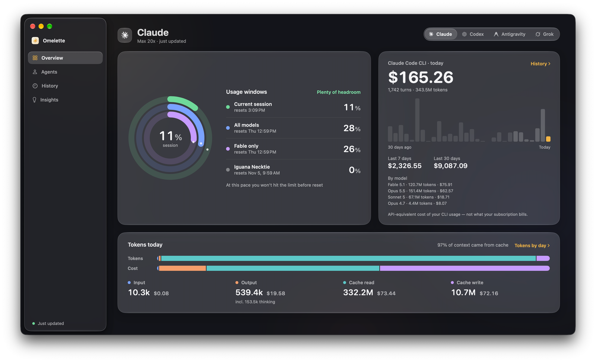</td>
  </tr>
  <tr>
    <td>The popover, All tab. An agent asked a question, so its row got Allow / Deny.</td>
    <td>Dashboard Overview. Tokens today: input, output (with thinking), cache read, cache write, and dollars per category.</td>
  </tr>
</table>

<details>
<summary><b>More of the popover</b>: one tab per provider, last-known numbers when one is closed</summary>
<br>
<table>
  <tr>
    <td>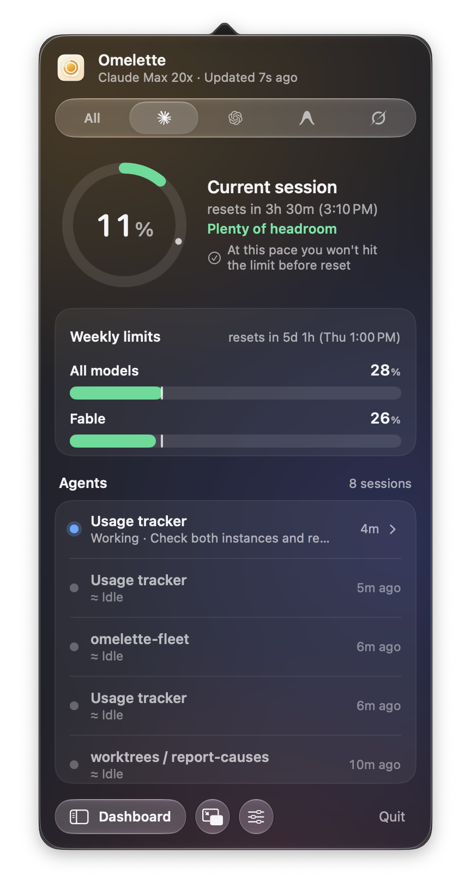</td>
    <td>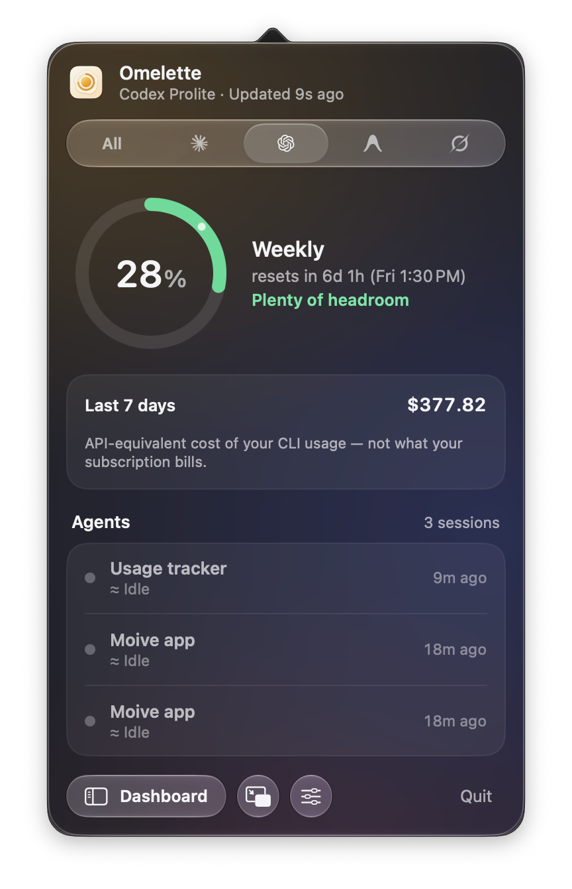</td>
    <td>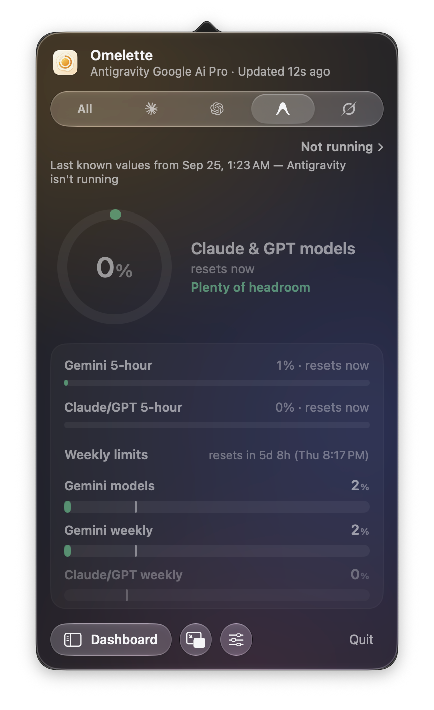</td>
    <td>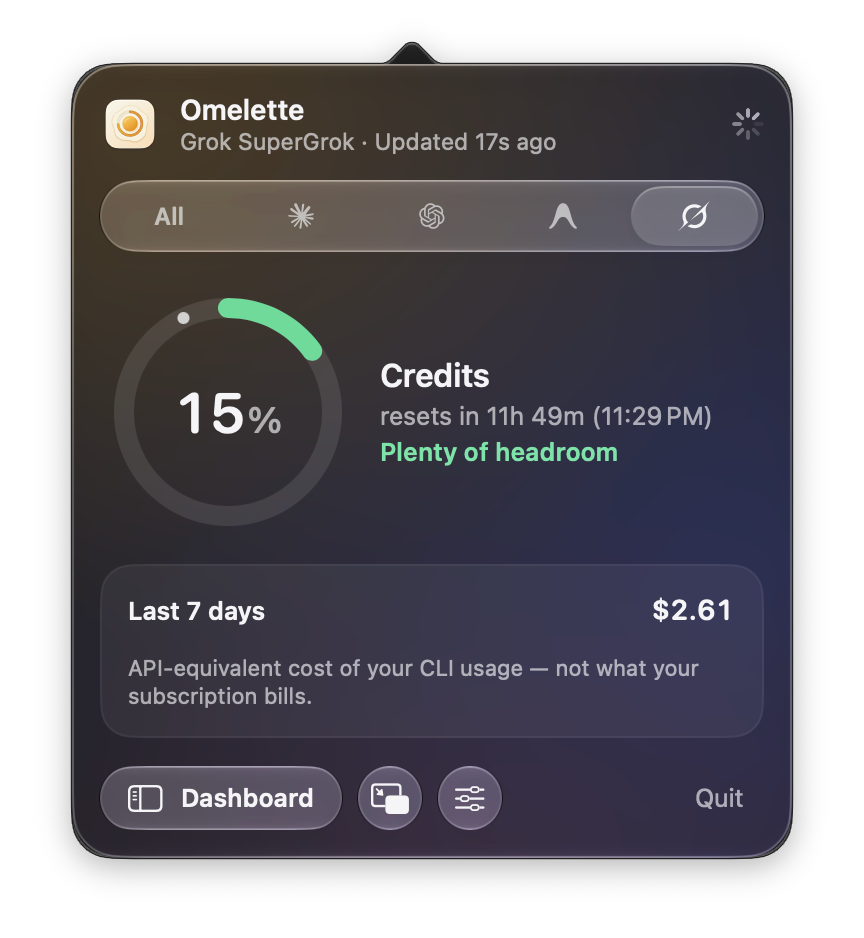</td>
  </tr>
  <tr>
    <td>Claude</td><td>Codex</td><td>Antigravity, closed: last known values, dimmed</td><td>Grok</td>
  </tr>
</table>
</details>

<details>
<summary><b>More of the dashboard</b>: overview per provider, history in dollars or tokens, quota history, calendar, agents, insights</summary>
<br>
<table>
  <tr>
    <td>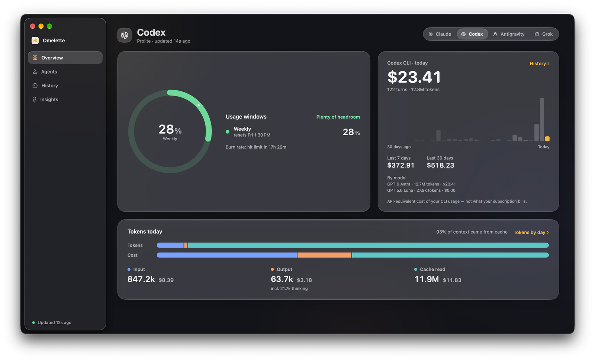</td>
    <td>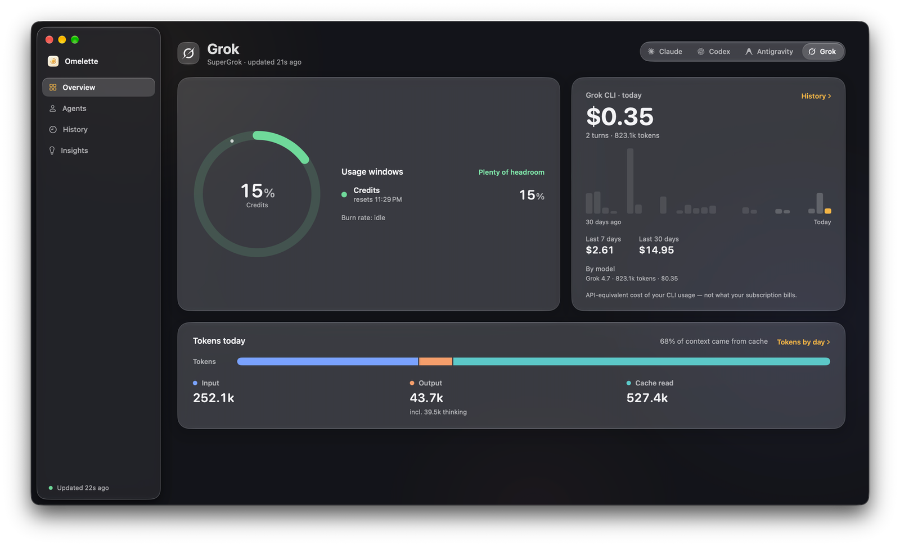</td>
  </tr>
  <tr><td>Overview, Codex</td><td>Overview, Grok</td></tr>
  <tr>
    <td>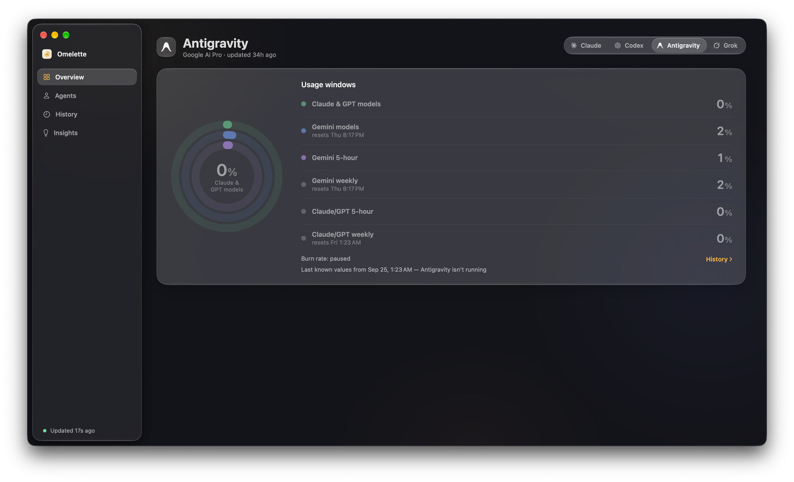</td>
    <td>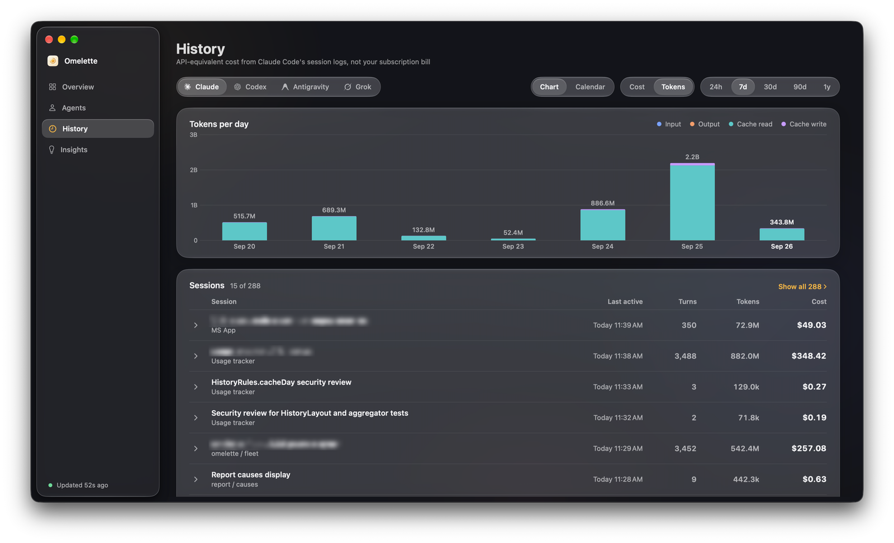</td>
  </tr>
  <tr><td>Overview, Antigravity closed: last known values</td><td>History, Tokens mode</td></tr>
  <tr>
    <td>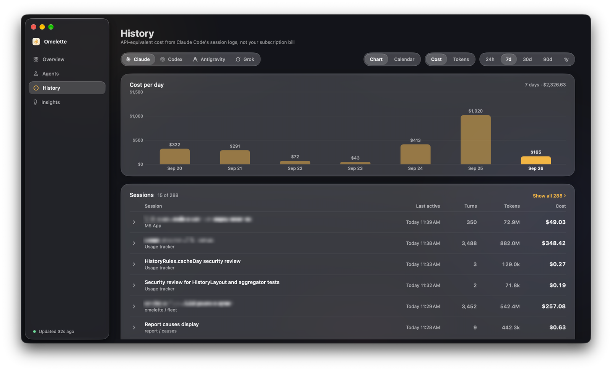</td>
    <td>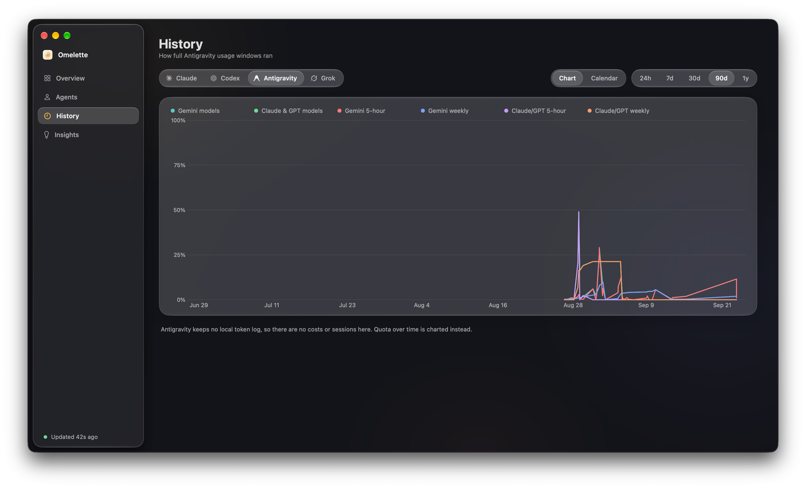</td>
  </tr>
  <tr><td>History, Cost mode</td><td>Quota history for a provider without a token log</td></tr>
  <tr>
    <td>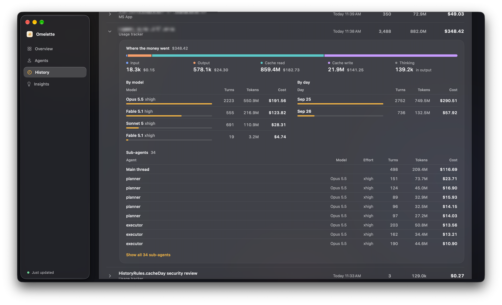</td>
    <td>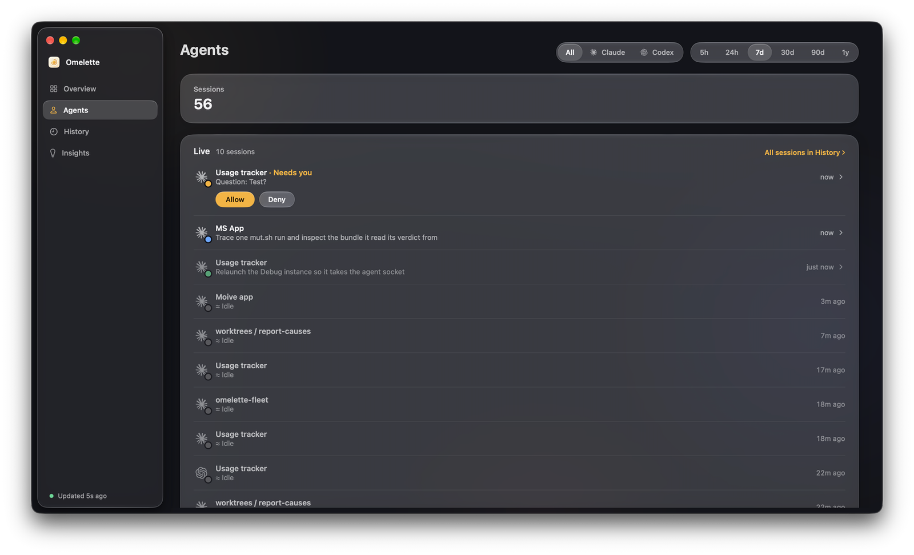</td>
  </tr>
  <tr><td>History: an open chat</td><td>Agents: live sessions</td></tr>
  <tr>
    <td colspan="2">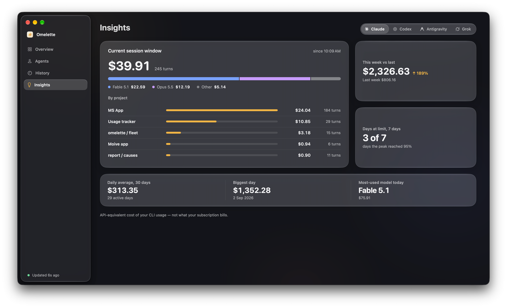</td>
  </tr>
  <tr><td colspan="2">Insights: what filled the current session window, ranked by project</td></tr>
</table>
</details>

Next: [What it shows](#what-it-shows).

## What it shows

If you use Claude Code, Codex, Antigravity or Grok, this is the
one place that shows where you stand across all of them, so a rate limit
never catches you mid-task.

| Provider | What you see |
|---|---|
| **Claude** | 5-hour session and weekly limits per model, decoded dynamically so a new model appears without an update; extra usage credits; Enterprise spend limits; Cloud session credits: shown as dollars, drives the menu bar only when it is all the account has |
| **Codex (OpenAI)** | session and weekly limits from the local Codex CLI; local dollar cost accounting from its session logs, now including compaction calls and sessions moved to `~/.codex/archived_sessions` |
| **Antigravity** | Antigravity's model-pool quotas, the path for personal Google accounts; per-model limits such as Gemini 4 Argon get their own row; while the app is closed or not answering, read through the `agy` CLI |
| **Grok (xAI)** | billing-period credit usage from the local Grok CLI, falling back to grok.com web billing when the CLI is unavailable |

- Costs come from local logs at models.dev list prices, never invented
  numbers. They are always API-equivalent, never your subscription bill
- In Claude Code's logs, a sub-agent's spend is attributed to the project
  that launched it
- **Last known numbers.** A provider that's closed or signed out keeps its
  last good reading, dimmed and dated ("Last known 14:05" on its tile), on every
  surface (island, dashboard, menu bar, widgets). A **Forget last
  known** link on that provider in Settings → Providers clears it on demand
- **Pay-as-you-go mode.** Accounts without rate windows get a "$ spent"
  pill and an optional weekly budget with percentage bars and alerts

Next: [Island](#island).

## Island

Click the notch. Brioche opens as an island that grows out of it, with every
provider in a two-column grid. Click a tile for that provider's page. On a Mac
or display without a notch it is a panel under the menu bar icon.

- **Open and close**: a click on the notch opens it. A click on the notch strip
  of the open island, a click outside it, or Esc at All closes it. Hovering the
  notch nudges it down a little and never opens it
- **Menu bar icon**: Settings → General → **Show in menu bar**. Off by default
  on a Mac with a notched display, so the icon is not there until you turn it
  on; click the notch instead. With no notched display attached (lid closed,
  an external display only) the icon is always shown
- **Navigation**: a provider's page has **‹ All** and the provider logos beside
  the notch. Esc, ‹ All, ⌘0 or a two-finger swipe right go back. **⌘0** is All
  and **⌘1–⌘9** are the providers in display order. With one provider on, its
  page is home
- **Ears**: with the island closed, the notch grows an ear when something needs
  you: a waiting agent, a signed-out Claude, a limit at 90 %, and ☾ for keep
  awake while the menu bar icon is hidden. A click on an ear does what it
  shows: the one waiting agent comes forward; otherwise the island opens on the
  agents list, that provider or keep awake. Settings → Pet turns them off

- **Tiles on All lead with the 5-hour session window**, the number people
  open the island to check, with the weekly window on the line below
- **The cost tile shows today's spend first**, with the 7-day total and the
  per-provider split underneath
- **Spend-limit and extra-usage providers show both dollar amounts under the
  ring** ("$431 of $1,500"), not a bare percentage
- **The agents list gives way to the screen**: two rows on a small display,
  five on a large one, the rest scrolls inside the list, so the limits, keep
  awake and the footer fit whenever the display has room for two agent rows
- **Footer**: Dashboard, floating window, Settings and Quit. ⌘R refreshes;
  the version and the update check live in Settings → General
- **Keep awake with the lid closed**: a block above the footer, see
  [Keep awake with the lid closed](#keep-awake-with-the-lid-closed)

Next: [Pet](#pet).

## Pet

A pixel pet stands in the island's left column, beside your limits. Cat, duck,
dog or raccoon, three colourways each. Pick one in Settings → Pet or in the
welcome tour.

- **It reacts**: a waiting agent, a signed-out Claude, a limit at 90 % or more,
  keep awake at night, agents working. A line under it says which
- **A click** does what the line says: jump to the waiting agent, sign in, open
  the provider at 90 %, show keep awake. Otherwise it pats the pet
- **It moves only while the island is open** and Reduce Motion is off
- **Off or smaller**: Settings → Pet → **Show the pet**. The column is also
  dropped on a display narrower than 1420 pt

Next: [Agents at a glance](#agents-at-a-glance).

## Agents at a glance

The island doubles as a control panel for the Claude Code and Codex
sessions you already have running.

- **Live sessions**: every session, grouped *Needs you / Working / Done /
  Idle*, with the project and what it's doing
- **Needs you** covers three things: a permission request, a question
  (`AskUserQuestion`), or a plan waiting for approval. Each shows the real
  text (the question's options, the plan's opening lines), one click away
- **Allow / Deny** from the notification and from the session's row, when
  its terminal isn't in front. Held for two minutes, then released
  untouched to the terminal if you don't answer; when the terminal is
  already in front, the CLI just asks there
- **Hooks for both CLIs**: eight Claude Code hooks in
  `~/.claude/settings.json`, seven Codex hooks in `~/.codex/hooks.json`,
  installed with one click (to see the exact text first, right-click the row in
  Settings → Integrations and choose **Copy what will be written**).
  Codex refuses a hook until you trust it once with `/hooks` inside Codex;
  Settings → Integrations says when that's still outstanding
- **Jump to the tab**: clicking a row brings its terminal back. Terminal and
  iTerm2 select the exact tab; tmux brings the attached client's window
  forward and selects the session, window and pane; cmux selects the exact
  workspace and surface over its own socket; Ghostty, Warp, kitty, Alacritty,
  WezTerm, VS Code, VS Code Insiders, Cursor and Windsurf all come to the
  front

Finished chats live in the dashboard's [History tab](#dashboard); the
Agents tab shows the same live rows full width.

Next: [Command line and MCP](#command-line-and-mcp).

## Command line and MCP

A tiny `brioche` tool ships inside the app, for the terminal and for your
agents. `omelette` is the same tool under its old name, so anything set up
before the rename keeps working: hooks, status line and MCP entries stay as
they are. To move an entry to the new name, press Disable, then Enable in
Settings → Integrations; an agent then calls its tools `mcp__brioche__*`.

Another tool, the [Brioche package manager](https://github.com/brioche-dev/brioche),
also installs a `brioche` command. Brioche never overwrites a file at its own
`bin/brioche`. If you have both and put the PATH line first, `brioche` runs this
app's tool: put the folder last instead
(`export PATH="$PATH:$HOME/Library/Application Support/UsageTracker/bin"`), and
use `omelette` for this one.

| Command | What it prints |
|---|---|
| `brioche status` | every provider's windows with exact reset times, today's and this week's cost, what your agents are doing |
| `brioche status --json` | the same snapshot as JSON, including each provider's recent chats |
| `brioche statusline [--provider ID] [--no-color]` | one line for a status bar (default: claude) |
| `brioche mcp` | a read-only MCP server on stdio |
| `brioche --version` / `--help` | version and usage |

`brioche statusline` installs with one click from Settings → Integrations →
Claude Code:
`Fable 5.1 [######----] 55% · cache 47m · ◐ 42% · resets in 1h 10m · ≈$4.20 today · ⚑ 1`,
where `cache 47m` is how long the session's prompt cache stays warm and
`cache cold` (red) means the next turn writes it again (after updating, switch
the status line off and on again in Settings → Integrations → Claude Code if
the timer does not show up), and where `≈` marks
API-equivalent dollars (`brioche status` writes "(API-equivalent)").
Or add it yourself to `~/.claude/settings.json` (Claude Code runs the command
through a shell, so `$HOME` expands):

```json
{
  "statusLine": {
    "type": "command",
    "command": "\"$HOME/Library/Application Support/UsageTracker/bin/brioche\" statusline",
    "refreshInterval": 60
  }
}
```

`refreshInterval` re-runs the command on a timer as well as on Claude Code's
own events, so the countdown keeps ticking while the session is idle. The
one-click install writes it too.

`brioche mcp` answers three tools. Nothing is written, nothing leaves your
Mac.

| Tool | Arguments | Returns |
|---|---|---|
| `get_usage` | none | every provider's windows, resets and costs |
| `get_agents` | none | which sessions are working or waiting on you |
| `get_sessions` | `provider` (`claude` or `codex`, optional), `limit` (1-15, default 10) | the recent chats: title, project, last active, turns, tokens, cost, sub-agent count, and each chat's share of the current limit windows (`sessionShare`, `weekShare`) or of the budget or spend limit (`budgetShare`) |

- One-click install for Claude Code (adds `brioche` to `~/.claude.json`)
  and Codex (adds an `[mcp_servers.brioche]` table to
  `~/.codex/config.toml`) from that same Settings section
- Or add it by hand:
  ```bash
  claude mcp add brioche -- "$HOME/Library/Application Support/UsageTracker/bin/brioche" mcp
  ```
  or, in `~/.codex/config.toml`:
  ```toml
  [mcp_servers.brioche]
  command = "/Users/you/Library/Application Support/UsageTracker/bin/brioche"  # full path, no $HOME
  args = ["mcp"]
  ```
- What an agent does with `get_usage`: before a long task it asks and waits
  for the reset, or picks a cheaper model. `get_sessions` is for a person
  checking what an agent has been doing and spending

Next: [Dashboard](#dashboard).

## Dashboard

A separate window, per provider, built from the same local logs. Opens from
the island footer or ⌘D.

- **Overview**: every window of the provider as concentric rings; hovering
  or focusing a legend row magnifies its ring and puts its figure in the
  centre. The CLI card shows today's spend by model and links to History;
  a spend-limit provider shows both dollar amounts
- **Tokens today**: input, output, cache read and cache write as bars
  against their cost, with thinking called out under output
- **History**: one controls row — provider, **Chart** or **Calendar**,
  range up to a year. The chart is Cost or Tokens per day with tooltips;
  the calendar is the GitHub-style year of squares (the former Activity
  tab). Under it, your chats: title, project, tokens and cost, expandable
  to the input/output/cache split, the sub-agents it launched and what each
  model cost. "Show all" reveals every chat with a Recent / Cost sort. A
  provider without a token log (Antigravity) gets a line chart of its
  windows instead. Claude Code deletes local transcripts after 30 days by
  default, so a fresh install can show less than a year — see
  [How it works](#how-it-works)
- **Insights**: days at limit in the last 7 days for every provider, this
  week vs last, the 30-day daily average, the biggest day, the most-used
  model today, and what filled the current session window by project. A
  quota-only provider shows its average daily peak, quota used per day and
  busiest day and hour instead
- **Limits**: Claude and Codex. What filled a session or weekly window, by
  chat or project, in percent points with their dollars; use from
  claude.ai, the desktop app or another machine is Outside this Mac. Pick
  the current window or a past one from the last 31 days; a timeline shows
  each half hour by project; a chat opens into its stretches between
  compactions and cold starts, with what each cold start cost; a chat run
  in a git worktree counts under the repository once Brioche has seen a
  session there. The first card prices
  one percent in dollars and tokens and says when a percent buys less than
  in recent weeks. A pay-as-you-go account sees its last 7 days of spend
  (on Claude, against the weekly budget when one is set), a spend-limit
  account its month against the limit
- **Agents tab**: the Sessions figure and the Live card (the same rows as
  the island, full width), with a link to History's chats
- The sidebar footer says when the numbers were last updated, with a status
  dot
- Every dollar figure here is the API-equivalent cost of your CLI usage,
  not what your subscription bills, except on a pay-as-you-go account,
  where it's the real bill

Next: [Notifications](#notifications).

## Notifications

- **Threshold alerts** at 80% and 95% (configurable), with quiet-hours support
- **Session-timing alerts**: "burning fast" (would hit the limit before
  the window resets) and "resets soon"
- **Daily summary**: wake up to "Yesterday: $4.20 across 23 turns"
- **Agent banners**: "needs you" (ignores quiet hours by default, opt-out)
  and "finished a turn" (opt-in), each naming its source ("Claude Code" or
  "Codex")

Next: [Widgets and floating window](#widgets-and-floating-window).

## Widgets and floating window

- **Desktop widgets**: per-provider Small / Medium / Large (right-click →
  Edit Widget to pick the provider) and an "All providers" overview widget
- **Floating mini window**: always-on-top, dockable to a corner, shows
  the leading window as a ring plus how many agent sessions are running

Next: [Keep awake with the lid closed](#keep-awake-with-the-lid-closed).

## Keep awake with the lid closed

Keeps a MacBook working with its lid closed for a set time, so agents carry on
in a bag or under a cat. Set it from the block above the island's footer; a ☾
in the menu bar says it is on. While the icon is hidden it moves to the notch's
right ear, unless the ears are off or that ear is showing a limit at 90 %; the
island's block always says.

- **Timed only**: days, hours and minutes (the fields stop at 7, 24 and 60), 1 minute to 7 d 23 h 59 min, then **Apply**;
  more than that is brought down to it on Apply, and the block says so.
  The block shows "Awake until 18:40 · 4 h 52 min left" and **Cancel**; Apply
  again replaces the deadline. The menu bar tooltip's first line says until when
- **Ends by itself**: at the deadline, even when Brioche is not running; on
  battery below 25 % (Settings → General → Keep awake → **End below 25 % on
  battery**, on by default); and at a restart, after which nothing resumes.
  The block says when and why it ended until you dismiss it or apply again
- **Sleep at the end**: when the mode ends at the deadline, at the battery
  floor, on Cancel or Reset, or through a helper restart while it was on, and
  the lid is closed with no external display keeping the Mac awake, the Mac
  goes to sleep. A helper switched off in Login Items only clears the flag
- **One-time approval**: the first Apply installs a helper,
  `omelette-keepawake`, that runs as root under launchd and sets macOS's sleep
  flag (`pmset disablesleep`). macOS announces it as **Background Items
  Added**; switch Brioche on (Omelette, if your copy updated from before 4.0)
  in System Settings → General → Login Items & Extensions, then press Apply again. macOS may ask for your password there
- **Reset**: Settings → Advanced → **Reset keep awake** asks first, then ends
  the mode, clears the flag, removes the helper from Login Items and puts the
  floor switch and the last duration back. It asks for an administrator
  password only when the helper cannot clear the flag; the line under it shows
  what `pmset -g` reports
- **Before deleting Brioche, press Reset keep awake.** An app deleted while
  keep awake is on leaves the flag set, and the Mac never sleeps, lid open or
  closed, until you run `sudo pmset -a disablesleep 0` in Terminal

Next: [Settings](#settings).

## Settings

A sidebar window with seven tabs.

- **General**: launch at login, Show in menu bar, refresh interval, the keep-awake battery
  floor, automatic updates and Check now, the version and the GitHub link
- **Menu bar**: the percentage mode, a "Count down remaining instead of
  used" switch that turns every ring, bar and percent around, which
  providers show in the menu bar, agents in the menu bar
- **Pet**: the pet on or off, the ears, the animal and its colourway
- **Providers**: one row per provider with its source, status and switch
  (Claude's too: off means not polled at all), and Forget last known
  inline. With every provider off, the menu bar, island and widgets say so.
  A signed-out Claude's row offers the way out that fits: **Sign in** when
  Claude Code is installed, the install link when it is not, and Settings ›
  Advanced when Brioche needs keychain access
- **Notifications**: the two limit warnings, session timing, agent alerts,
  quiet hours and the daily summary
- **Integrations**: Claude Code (hooks, status line, MCP server), Codex
  (hooks, `notify`, MCP server, the trust line), the Allow/Deny switch,
  Command line (PATH)
- **Advanced**: keychain access, optional Admin API key, pay-as-you-go
  weekly budget, the `anthropic-beta` flag, agent diagnostics (socket, last
  event, the pending/answered/expired counts), replay the welcome tour,
  Reset keep awake, reset all settings

Old deep links still open the right tab (Agents → Integrations, Account →
Providers).

Next: [How it works](#how-it-works).

## How it works

Reads the OAuth token that **Claude Code** stores in your macOS Keychain
(item name `Claude Code-credentials`) and calls
`https://api.anthropic.com/api/oauth/usage`, the same undocumented endpoint
Claude Code itself uses for its `/usage` command and status line. Brioche
never refreshes that token itself and keeps it in memory only: when it has
expired (it lives 8 hours), Brioche starts Claude Code for a few seconds so
Claude Code renews it. With no Claude Code sign-in on the Mac (the Claude app
alone), **Sign in** in the island opens Terminal on Claude Code's own
`claude auth login`. Brioche writes that command to
`~/Library/Application Support/UsageTracker/claude-sign-in.command` for
Terminal to run and leaves it there; it holds no secret.
Other providers are read the same reuse-what's-already-there way: the local
Codex CLI's RPC server, a running Antigravity's local language server (while
the app is closed or not answering, Antigravity's own `agy` CLI), or the local
Grok CLI (with a grok.com fallback).

Cost and the History calendar are read from the CLIs' own logs, so they reach back as far
as those logs do — up to a year. Claude Code deletes its local transcripts
after 30 days by default; raise `cleanupPeriodDays` in `~/.claude/settings.json`
to keep a year of them:

```json
{
  "cleanupPeriodDays": 365
}
```

- Uses only your own credentials, obtained by the tools themselves. Sign in
  runs Claude Code's own sign-in in Terminal; Brioche never sees a password
  and never asks for a token
- Talks only to: `api.anthropic.com` (usage endpoint, plus Enterprise cost
  reports if you add an Admin API key), `models.dev` (public pricing data),
  `cloudcode-pa.googleapis.com` and `oauth2.googleapis.com` (Antigravity's quota
  while it is closed and agy has no reading, with the sign-in Antigravity saved,
  whenever the Antigravity provider is on), `grok.com` and
  `cli-chat-proxy.grok.com` (Grok's plan tier on each poll and its billing when
  the CLI can't answer, with the sign-in the Grok CLI saved, whenever the Grok
  provider is on), `github.com` and
  `adxd-og.github.io` (Sparkle update feed and DMG download), and local RPC
  to the Codex CLI or Antigravity's language server. The `agy` CLI, when
  Brioche runs it, talks to Google itself under its own sign-in
- While Antigravity is closed or not answering, runs its CLI as
  `agy -p /usage` in the background about every five minutes and stops it
  after 45 s or on a normal quit. agy gets none of Brioche's environment
  beyond HOME, USER, LOGNAME, TMPDIR, LANG and a system PATH, and logs the run
  to one file, `agy-usage.log` in Brioche's Application Support folder;
  Brioche reads only the quota it prints, and skips the run unless the login
  keychain is unlocked
- When Claude Code's sign-in has expired, starts `claude` (the one on your
  PATH, else the Claude app's own copy) on a terminal of its own in
  `~/Library/Application Support/UsageTracker/ClaudeRenewal` for 8 s, at most
  every 5 minutes, and only while the login keychain is unlocked and Claude
  Code's item reads without a prompt; quitting Brioche stops it. Nothing is
  typed into it (it only gets a terminal's answer when it asks where the
  cursor is) and no message is sent; it runs without `CLAUDE_CONFIG_DIR`,
  `CLAUDE_CODE_OAUTH_TOKEN`,
  `CLAUDECODE` or `ANTHROPIC_*`, with updates, telemetry and non-essential
  traffic switched off (on a fresh configuration Claude Code still fetches
  its plugin list), and talks to Anthropic as Claude Code always does. The
  transcripts in its own project folder under `~/.claude/projects` are
  removed; Claude Code's own bookkeeping (`history.jsonl`, `sessions/`, a
  `.claude.json` backup) stays
- Agent status comes from a tiny `omelette-hook` helper inside the app that
  Claude Code and Codex run on their hook events. It talks to Brioche over
  a local Unix socket (0600, 64 KB cap) and forwards only the session id,
  tool name, a truncated summary, folder and host process, never prompts
  or file contents. Every hook exits within 0.8 s except a permission
  request, which the helper holds open for up to 140 s so Brioche can
  answer Allow/Deny; a helper that gets no reply always fails safe
- Keep awake's helper, `omelette-keepawake`, runs as root under launchd once
  you approve it in Login Items. It answers only Brioche signed by the same
  developer team, runs nothing but `/usr/bin/pmset`, clears its own sleep flag
  every time it starts (a flag set by another tool or by hand is left alone,
  until an Apply takes it over: the end of that mode clears it),
  and exits a minute after it has nothing to do
- The `brioche` command-line tool and MCP server only ever read
  `~/Library/Application Support/UsageTracker/status.json`, written after
  every poll. They never start the app, open a socket, or touch the network
- Polls at human-paced intervals (default 60s), honours server `Retry-After`
- **No telemetry, no analytics.** Usage history and cost accounting stay
  on your Mac
- Open source end to end. Audit anything above

Next: [Requirements](#requirements).

## Requirements

- macOS 26 (Tahoe) or newer from version 3.0 on
- On macOS 14 or 15, [Omelette 2.7.1](../../releases/tag/v2.7.1) is the last version
  that runs; an installed copy stays on it and is not offered 3.0
- [Claude Code](https://docs.anthropic.com/claude-code) or the Claude app.
  Without a Claude Code sign-in, **Sign in** in the island runs Claude
  Code's own sign-in in Terminal
- Works with Pro / Max / Team / Enterprise subscriptions **and**
  pay-as-you-go Enterprise accounts
- Optional: Codex CLI (ChatGPT sign-in), Antigravity (Google sign-in), and/or
  Grok CLI (xAI sign-in) for their providers
- No extra setup for the terminal: Terminal, iTerm2, tmux, cmux and every
  other supported host work out of the box

Next: [Install](#install).

## Install

1. Download the latest `Brioche.dmg` from [Releases](../../releases)
2. Open the DMG and drag `Brioche.app` to `~/Applications/` (or `/Applications/`).
   Upgrading from Usage Checker ≤ 1.5? Delete the old `UsageChecker.app` first.
   Settings, history and widgets carry over automatically.

   Upgrading from Omelette? You don't need the DMG: it updates itself, stays
   `Omelette.app` on disk and keeps everything. If you install the DMG anyway,
   delete `Omelette.app` first (press **Reset keep awake** in Settings → Advanced
   before that, if you use keep awake), so one copy runs.
3. Launch it. In the welcome tour, press **Grant access**: macOS asks to read the
   `Claude Code-credentials` Keychain item. Click **Always Allow**. From then on Brioche reads it
   without that dialog and keeps what it read in memory only. It can
   reappear after something resets the item's access list (a reinstall, or a
   differently signed build); Settings → Advanced → **Request keychain access
   now** brings it back on demand
4. Click the notch to open Brioche. On a Mac or display without a notch, click
   the menu bar icon instead
5. That's the last manual install. Updates arrive automatically via Sparkle
   (signed & notarized), or on demand via Settings → General → **Check now**

Next: [Build from source](#build-from-source).

## Build from source

See [CONTRIBUTING.md](CONTRIBUTING.md).

TL;DR:
```bash
brew install xcodegen
./scripts/setup.sh      # creates signing.xcconfig from the example
./scripts/build_dmg.sh
```

Next: [Disclaimer](#disclaimer).

## Disclaimer

`/api/oauth/usage` is an **undocumented** endpoint that the official Claude Code CLI uses internally. Anthropic may change or remove it at any time. If that happens, Brioche keeps showing Claude's last known numbers, dimmed, and says Error until it's updated.

Brioche is **not** affiliated with or endorsed by Anthropic.

Next: [License](#license).

## License

[MIT](LICENSE). Do what you like, no warranty.
